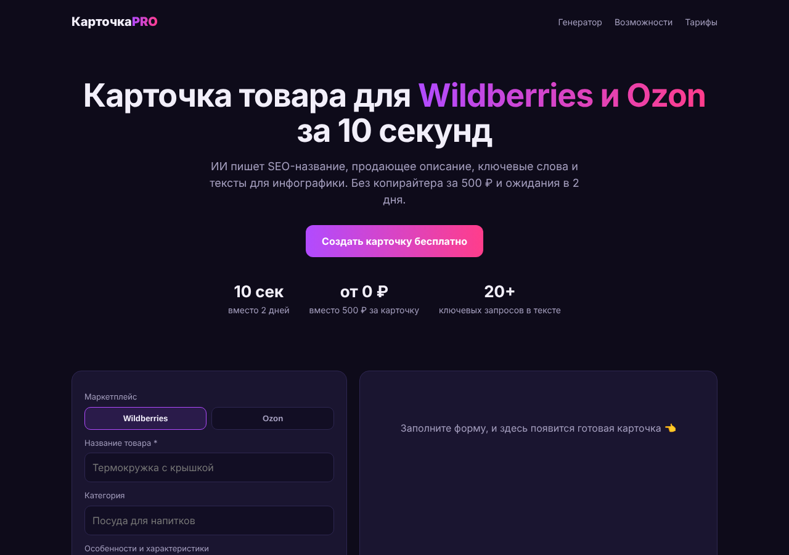

# КарточкаPRO

ИИ-сервис, который за 10 секунд пишет продающие SEO-карточки для Wildberries и Ozon: название под лимит площадки, описание, ключевые слова, преимущества и тексты для инфографики.



**Что есть:**
- сайт с генератором и тарифами (работает на телефоне);
- Telegram-бот с тем же генератором;
- приём оплаты через ЮKassa с автоматической выдачей PRO-кода;
- бесплатный лимит (3 карточки в день) и PRO без ограничений;
- хранение данных в файле: всё сохраняется после перезапуска;
- 27 автотестов, Dockerfile и конфиг для Render.

## Быстрый старт

```bash
npm install
cp .env.example .env     # заполните нужное
npm start                # http://localhost:3000
npm test                 # автотесты
```

Без ключей сервис работает в **демо-режиме**: тексты собираются по шаблонам, оплата выключена. Каждая функция включается своей переменной в `.env`:

| Что | Переменные | Где взять |
|---|---|---|
| ИИ-тексты | `ANTHROPIC_API_KEY` | console.anthropic.com → API Keys |
| Оплата | `YOOKASSA_SHOP_ID`, `YOOKASSA_SECRET_KEY` | yookassa.ru → Интеграция → Ключи API |
| Telegram-бот | `TELEGRAM_BOT_TOKEN`, `TELEGRAM_BOT_USERNAME` | @BotFather → /newbot |
| Адрес сайта | `BASE_URL` | ваш домен (нужен для возврата после оплаты) |

## Запуск в интернете

**Вариант 1. Render.com (проще всего).** New → Blueprint → выбрать этот репозиторий. Render прочитает `render.yaml`, останется вписать ключи. Тариф Starter (~$7/мес) нужен ради диска: на бесплатном тарифе PRO-коды пропадут при перезапуске.

**Вариант 2. Любой VPS с Docker** (Timeweb, Selectel и др., от ~300 ₽/мес):
```bash
docker build -t kartochka .
docker run -d --restart=always -p 80:3000 --env-file .env -v kartochka-data:/app/data kartochka
```
Для HTTPS поставьте перед контейнером Caddy или nginx и задайте `TRUST_PROXY=1`.

**После деплоя в ЮKassa:** Интеграция → HTTP-уведомления → URL `https://ваш-домен/api/yookassa/webhook`, событие `payment.succeeded`. Вебхук ускоряет выдачу кода. Даже без него код выдаётся, когда покупатель возвращается на сайт.

## Как работает оплата

1. Покупатель жмёт «Подключить PRO». Сервер создаёт платёж в ЮKassa, покупатель уходит на страницу оплаты.
2. После оплаты ЮKassa возвращает его на `/?order=…`, и сайт спрашивает сервер о статусе.
3. Сервер **сам запрашивает платёж у ЮKassa** и проверяет статус, сумму, валюту и номер заказа. Только после этого он выдаёт код `PRO-XXXXXXXXXX`. Подделать оплату запросом на вебхук нельзя.
4. Код сохраняется в браузере. В Telegram его активируют командой `/pro КОД`.

Для приёма платежей нужен статус самозанятого или ИП.

## Экономика: проверьте до запуска рекламы

По умолчанию используется `claude-opus-5-5` (самая качественная модель, $4 / $20 за 1 млн токенов). Одна карточка — это примерно 1 тыс. входных и 2–3 тыс. выходных токенов, то есть **около 3–5 ₽**. Это оценка: реальный расход каждой генерации пишется в лог сервера (`usage … in=… out=…`).

| | Opus 5.5 (по умолчанию) | Sonnet 5.5 | Haiku 5.5 |
|---|---|---|---|
| ≈ стоимость карточки | 3–5 ₽ | 1,5–2,5 ₽ | < 0,2 ₽ |
| 100 карточек PRO-пользователя | 300–500 ₽ | 150–250 ₽ | < 20 ₽ |

При цене PRO 490 ₽ в месяц на Opus активный пользователь почти «съедает» выручку, а бесплатный лимит стоит денег на каждого посетителя. Варианты:
- сравнить качество текстов и переключить модель одной строкой: `MODEL=claude-sonnet-5-5` или `MODEL=claude-haiku-5-5`;
- уменьшить `FREE_PER_DAY`;
- поднять цену или ввести лимит в PRO.

**Цель:** 200 PRO-подписчиков ≈ 98 000 ₽/мес выручки.

## План запуска (4 недели)

1. **Неделя 1.** Самозанятость, ЮKassa, деплой, домен. Проверить реальную стоимость карточки по логам и выбрать модель.
2. **Неделя 2.** Первые пользователи из Telegram-чатов селлеров WB/Ozon, с VC.ru и форумов. Бесплатный месяц PRO первым 50 пользователям в обмен на отзыв.
3. **Неделя 3.** Короткие видео «карточка за 10 секунд: до и после» в Shorts, Reels и TikTok.
4. **Неделя 4.** Партнёрка: 30% с оплат блогерам и курсам по маркетплейсам.

## Структура

```
server.js          запуск: читает .env, собирает модули
lib/generate.js    промпт, вызов Claude (structured outputs + fallback), демо-режим
lib/app.js         HTTP API и статика
lib/payments.js    ЮKassa: создание платежа, проверка, выдача кода
lib/store.js       хранилище в JSON-файле (атомарная запись)
lib/bot.js         Telegram-бот (long polling)
public/index.html  сайт
test/              автотесты (node --test)
```

## Что дальше

- Регистрация через e-mail, чтобы не терять PRO-код
- Массовая генерация из Excel
- Анализ карточек конкурентов по ссылке
- Автопродление подписки (рекуррентные платежи ЮKassa)
- Переход с JSON-файла на SQLite/PostgreSQL при росте нагрузки
